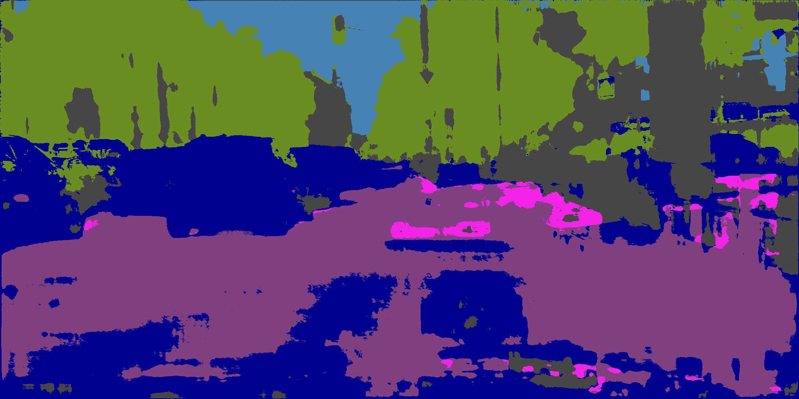
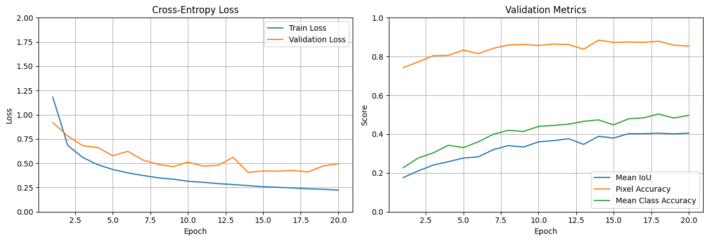

# v1.0.2-1024-2048-baseline



GIF: `frankfurt_000001_012038_leftImg8bit.png`

## Training

CPU: 10700KF | RAM: 32GB | GPU: RTX 2080S 8GB

20 EPOCHS = **5hrs 4mins**     

- BATCH 1 
- WORKER 0 
- BASE 32 
- LEARNING_RATE = 1e-4 
- WEIGHT_DECAY = 1e-4 

criterion = `nn.CrossEntropyLoss(ignore_index=IGNORE_INDEX)`

optimizer = `torch.optim.AdamW(model.parameters(), lr=LEARNING_RATE, weight_decay=WEIGHT_DECAY,)`



Saved:

```
Epoch 14/20 | train loss: 0.2701 | valid loss: 0.4061 | mIoU: 0.3891 | pixel acc: 0.8845 | class acc: 0.4735 | ETA: 01:30:23
```

## Evaluation

Test evaluation: `['dusseldorf', 'jena', 'stuttgart']`

```
Pixel Accuracy:       90.0533%
Mean IoU (mIoU):      39.9852%
Mean Class Accuracy:  48.5771%

Per-class results:
-------------------------------------------------------
road                 IoU:   93.8515% | Accuracy:   96.6901%
sidewalk             IoU:   63.2847% | Accuracy:   75.8969%
building             IoU:   83.4419% | Accuracy:   93.1218%
wall                 IoU:    2.8582% | Accuracy:    2.9298%
fence                IoU:   19.7330% | Accuracy:   23.9050%
pole                 IoU:   37.5109% | Accuracy:   50.6358%
traffic light        IoU:   29.9516% | Accuracy:   40.2007%
traffic sign         IoU:   46.6574% | Accuracy:   64.2772%
vegetation           IoU:   84.4344% | Accuracy:   92.5728%
terrain              IoU:   44.0854% | Accuracy:   59.1264%
sky                  IoU:   89.6218% | Accuracy:   94.6262%
person               IoU:   53.8086% | Accuracy:   71.7291%
rider                IoU:    0.0000% | Accuracy:    0.0000%
car                  IoU:   79.5806% | Accuracy:   94.2094%
truck                IoU:    0.0000% | Accuracy:    0.0000%
bus                  IoU:    0.0006% | Accuracy:    0.0006%
train                IoU:    0.0000% | Accuracy:    0.0000%
motorcycle           IoU:    0.0023% | Accuracy:    0.0023%
bicycle              IoU:   30.8957% | Accuracy:   63.0400%
```

## Conclusions

This was the first model trained on the full **1024 x 2048** resolution. 

Training was slow due to limited resources. Batch size had to be reduced to 1, using 6GB VRAM out of 8GB available. The training loop consisted of a training forward + backward passes over training set, validation loss forward pass over validation set and evaluate forward pass over validation set. The validation and evaluate forward pass could possibly be combined to avoid two forward passes.

90% pixel accuracy is not as meaningful as the 40% mIoU. This performance with a relatively small model and limited resources is OK, but there is room to improve. 

Large frequent classes are learned well, but rare classes are mostly missing entirely. The gap between common and rare classes is substantial. The 0% accuracy for rare classes is not due to incorrect mask mapping as training and evaluating the same model at scaled down 64 x 128 resolution results in a per class accuracy of at least 11%.

The validation and test set evaluations yield similar results, which is a sign of good generalization. Data leakage is unlikely.

Validation loss stalls quite early and fluctuates, possibly overfitting.

Observing the sample output prediction per epoch demonstrated in the gif shows a few patterns. Large classes appear first, smaller classes appear later, but some rare objects never appear. Checkerboard patterns appear sometimes and thin structures vanish. Classes dominate during an certain epochs, which could be a sign of instability.