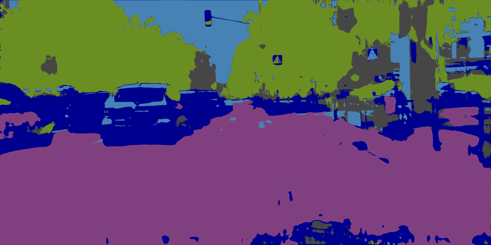
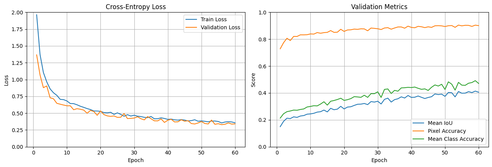
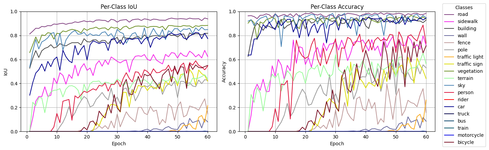

# v1.1.0-512-1024



GIF: `frankfurt_000001_012038_leftImg8bit.png`

## Data Prep

LabelIds -> TrainIds

Random crops 512 x 1024, scaled 0.5-2.0x

Random horizontal flips

Evaluation remains 1024 x 2048 resolution

## Model

Total params: 7,766,579

## Training

CPU: 10700KF | RAM: 32GB | GPU: RTX 2080S 8GB

Trained on 512 x 1024 crops for 40 EPOCHS + 20 EPOCHS

40 EPOCHS = **2hrs 20mins**     
20 EPOCHS = **1hr 3mins**    

- CROP_SIZE = (512, 1024)
- CROP_SCALE = (0.5, 2.0)
- FLIP = True
- TRAIN_BATCH_SIZE = 6
- EVAL_BATCH_SIZE = 1 
- WORKER = 2 
- BASE = 32 
- LEARNING_RATE = 1e-4 
- WEIGHT_DECAY = 1e-4 

criterion = `nn.CrossEntropyLoss(ignore_index=IGNORE_INDEX)`

optimizer = `torch.optim.AdamW(model.parameters(), lr=LEARNING_RATE, weight_decay=WEIGHT_DECAY,)`





Saved:

```
Epoch 56/60 | train loss: 0.3545 | valid loss: 0.3292 | mIoU: 0.3989 | pixel acc: 0.9031 | class acc: 0.4568 | ETA: 00:03:38
```

## Evaluation

Test evaluation: `['dusseldorf', 'jena', 'stuttgart']`

```
Pixel Accuracy:       90.9222%
Mean IoU (mIoU):      39.6777%
Mean Class Accuracy:  45.1417%

Per-class results:
-------------------------------------------------------
road                 IoU:   94.4652% | Accuracy:   98.4124%
sidewalk             IoU:   62.8498% | Accuracy:   70.2273%
building             IoU:   83.8823% | Accuracy:   95.0871%
wall                 IoU:   10.6063% | Accuracy:   11.3150%
fence                IoU:   22.4212% | Accuracy:   27.2622%
pole                 IoU:   28.9550% | Accuracy:   32.9692%
traffic light        IoU:    1.8438% | Accuracy:    1.8587%
traffic sign         IoU:   39.4879% | Accuracy:   41.6547%
vegetation           IoU:   85.3682% | Accuracy:   94.4207%
terrain              IoU:   53.7657% | Accuracy:   65.4813%
sky                  IoU:   89.7876% | Accuracy:   95.4901%
person               IoU:   59.2462% | Accuracy:   68.8794%
rider                IoU:    0.0008% | Accuracy:    0.0008%
car                  IoU:   84.9270% | Accuracy:   94.2190%
truck                IoU:    0.0000% | Accuracy:    0.0000%
bus                  IoU:    0.0000% | Accuracy:    0.0000%
train                IoU:    0.0000% | Accuracy:    0.0000%
motorcycle           IoU:    0.0000% | Accuracy:    0.0000%
bicycle              IoU:   36.2703% | Accuracy:   60.4151%
```

## Conclusions

This model was trained on **512 x 1024** resolution crops, which resulted in much faster learing. The validation loss and metrics evaluation forward passes were combined into one, further reducing training time. Better VRAM utilization.

Model was trained for 40 EPOCHS, then evaluated. There were no signs of overfitting and the performance seemed to keep increasing.

The model was restored from the checkpoint trained for another 20 EPOCHS. The checkpoint did not save the scaler or best mIoU. These should be saved in the future. 

The model trained for ~1.5hrs less, but results were similar. Just like the baseline, some rare classes were not captured. Saving metric history shows certain rare classes start to appear in late stages of training. Targeting these rare classes to boost mIoU and mean class accuracy should be a priority.

The crops and horizontal flips worked well to prevent overfitting. Training loss is no longer much lower than validation loss.

Visual inspection of sampled outputs per epoch shows more consistent masks.