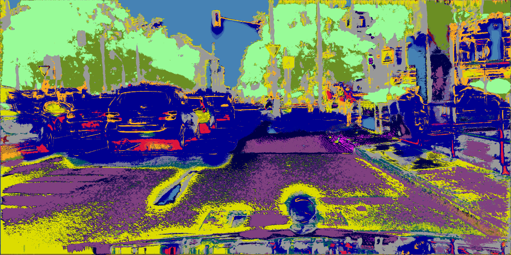
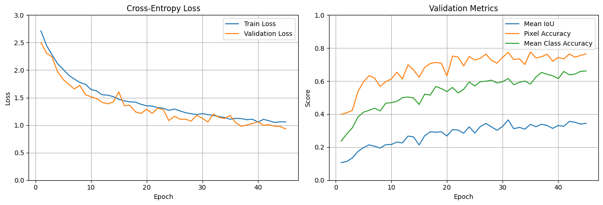
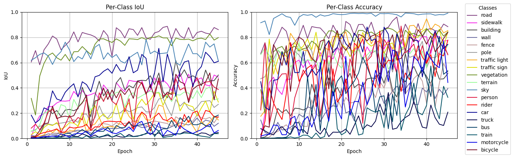

# v1.2.1-512-1024



GIF: `frankfurt_000001_012038_leftImg8bit.png`

## Data Prep

LabelIds -> TrainIds

Random crops 512 x 1024, scaled 0.5-2.0x

Random horizontal flips

Evaluation remains 1024 x 2048 resolution

## Model

Total params: 7,766,579

## Training

CPU: 10700KF | RAM: 32GB | GPU: RTX 2080S 8GB

Trained on 512 x 1024 crops for 45 EPOCHS

45 EPOCHS = **2hrs 32mins**      

- CROP_SIZE = (512, 1024)
- CROP_SCALE = (0.5, 2.0)
- FLIP = True
- TRAIN_BATCH_SIZE = 6
- EVAL_BATCH_SIZE = 1 
- WORKER = 2 
- BASE = 32 
- LEARNING_RATE = 1e-4 
- WEIGHT_DECAY = 1e-4 

Raw weights based on frequency from exploratory data analysis
```
freq = [36.779, 6.392, 22.557, 0.622, 0.899, 1.241, 0.206, 0.549, 16.102, 1.158, 4.108, 1.227, 0.147, 6.735, 0.233, 0.260, 0.237, 0.096, 0.450]
```

Median frequency balancing applied
```
weights = freq.median() / freq
```

criterion = `nn.CrossEntropyLoss(weight=weights.to(device), ignore_index=IGNORE_INDEX)`

optimizer = `torch.optim.AdamW(model.parameters(), lr=LEARNING_RATE, weight_decay=WEIGHT_DECAY)`





Saved:

```
Epoch 31/60 | train loss: 1.1912 | valid loss: 1.0567 | mIoU: 0.3651 | pixel acc: 0.7745 | class acc: 0.6158 | ETA: 01:38:01
```

## Evaluation

Test evaluation: `['dusseldorf', 'jena', 'stuttgart']`

```
Pixel Accuracy:       78.2584%
Mean IoU (mIoU):      36.9818%
Mean Class Accuracy:  62.0834%

Per-class results:
-------------------------------------------------------
road                 IoU:   85.5434% | Accuracy:   89.2667%
sidewalk             IoU:   40.9122% | Accuracy:   72.9366%
building             IoU:   55.8121% | Accuracy:   57.7354%
wall                 IoU:   12.6730% | Accuracy:   41.6020%
fence                IoU:   13.4899% | Accuracy:   62.7620%
pole                 IoU:   24.8154% | Accuracy:   59.3628%
traffic light        IoU:   24.2557% | Accuracy:   75.1641%
traffic sign         IoU:   32.7504% | Accuracy:   73.0064%
vegetation           IoU:   78.1277% | Accuracy:   85.5749%
terrain              IoU:   47.2375% | Accuracy:   65.9023%
sky                  IoU:   77.4454% | Accuracy:   97.9921%
person               IoU:   47.8537% | Accuracy:   62.5404%
rider                IoU:   14.9477% | Accuracy:   66.1318%
car                  IoU:   74.1176% | Accuracy:   87.1782%
truck                IoU:    5.2248% | Accuracy:   31.6648%
bus                  IoU:    3.6986% | Accuracy:    7.7021%
train                IoU:    5.2902% | Accuracy:   18.6013%
motorcycle           IoU:   25.4289% | Accuracy:   58.7705%
bicycle              IoU:   33.0294% | Accuracy:   65.6906%
```

## Conclusions

Model trained on **512 x 1024** resolution crops like before, only loss function changed to have weights.

The weights were added to help with class imbalance. Rare classes appeared almost instantly, but large classes are being suppressed.

Mean Class Accuracy increased by ~14%, while mIoU dropped slightly and overall pixel accuracy decreased ~12% from the baseline. The weights are probably too aggressive. 

Cross Entropy loss is per pixel, which is good for accuracy, but IoU is the more important target measure here. A different loss approach should be considered.

Model could be trained for longer as no signs of overfitting to get better results. This run was enough to reflect on.

