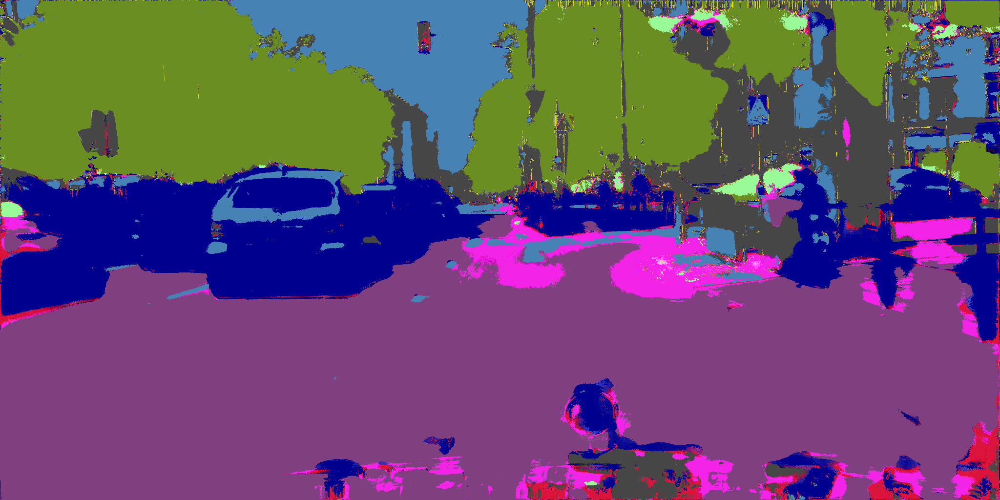
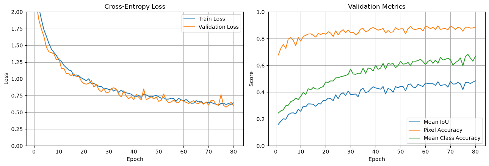
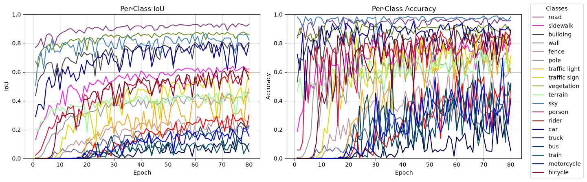

# v1.2.2-512-1024



GIF: `frankfurt_000001_012038_leftImg8bit.png`

## Data Prep

LabelIds -> TrainIds

Random crops 512 x 1024, scaled 0.5-2.0x

Random horizontal flips

Evaluation remains 1024 x 2048 resolution

## Model

Total params: 7,766,579

## Training

CPU: 14700KF | RAM: 32GB | GPU: RTX 4080S 16GB

Trained on 512 x 1024 crops for 80 EPOCHS

80 EPOCHS = **2hrs 2mins**      

- CROP_SIZE = (512, 1024)
- CROP_SCALE = (0.5, 2.0)
- FLIP = True
- TRAIN_BATCH_SIZE = 10
- EVAL_BATCH_SIZE = 2 
- WORKER = 8 
- BASE = 32 
- LEARNING_RATE = 1e-4 
- WEIGHT_DECAY = 1e-4 
- WEIGHT_EXPONENT = 0.5

Raw weights based on frequency from exploratory data analysis
```
freq = [36.779, 6.392, 22.557, 0.622, 0.899, 1.241, 0.206, 0.549, 16.102, 1.158, 4.108, 1.227, 0.147, 6.735, 0.233, 0.260, 0.237, 0.096, 0.450]
```

Median frequency balancing applied with an exponent weight
```
weights = (freq.median() / freq) ** WEIGHT_EXPONENT
```

criterion = `nn.CrossEntropyLoss(weight=weights.to(device), ignore_index=IGNORE_INDEX)`

optimizer = `torch.optim.AdamW(model.parameters(), lr=LEARNING_RATE, weight_decay=WEIGHT_DECAY)`





Saved:

```
Epoch 80/80 | train loss: 0.6407 | valid loss: 0.5956 | mIoU: 0.4846 | pixel acc: 0.8869 | class acc: 0.6667 | ETA: 00:00:00
```

## Evaluation

Test evaluation: `['dusseldorf', 'jena', 'stuttgart']`

```
Pixel Accuracy:       89.5973%
Mean IoU (mIoU):      49.1373%
Mean Class Accuracy:  68.8550%

Per-class results:
-------------------------------------------------------
road                 IoU:   93.6639% | Accuracy:   95.5570%
sidewalk             IoU:   61.3467% | Accuracy:   83.8242%
building             IoU:   83.3755% | Accuracy:   89.4875%
wall                 IoU:   27.7069% | Accuracy:   50.5516%
fence                IoU:   25.9166% | Accuracy:   66.4538%
pole                 IoU:   40.9304% | Accuracy:   54.8225%
traffic light        IoU:   47.2527% | Accuracy:   67.7950%
traffic sign         IoU:   56.8754% | Accuracy:   70.4626%
vegetation           IoU:   83.9974% | Accuracy:   86.9146%
terrain              IoU:   55.8019% | Accuracy:   77.5542%
sky                  IoU:   88.6188% | Accuracy:   98.0782%
person               IoU:   62.3713% | Accuracy:   74.3180%
rider                IoU:   21.3296% | Accuracy:   61.1641%
car                  IoU:   82.9285% | Accuracy:   91.1401%
truck                IoU:    4.5706% | Accuracy:    4.8580%
bus                  IoU:   12.4873% | Accuracy:   53.4275%
train                IoU:   21.7140% | Accuracy:   46.0736%
motorcycle           IoU:   24.1317% | Accuracy:   52.1989%
bicycle              IoU:   38.5894% | Accuracy:   83.5627%
```

## Conclusions

Model trained on **512 x 1024** resolution crops, with the loss function weights scaled down. 

There were no signs of overfitting and good progress, training could have continued further. 

The weights adjustment made a positive impact on the mIoU. The mean class accuracy reduced but overall accuracy increased as expected with this weight adjustment.

Still struggling with classes like truck and overpredicting classes like bus, train or motorcycle.

The learning rate could be adjusted and the loss function could be changed to focus on IoU.