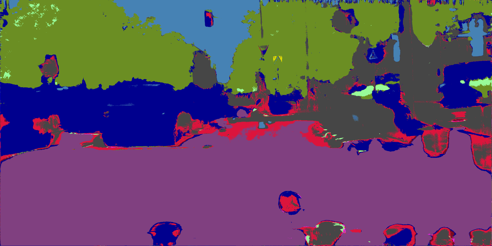
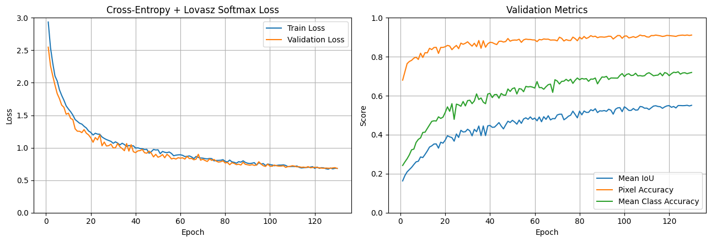
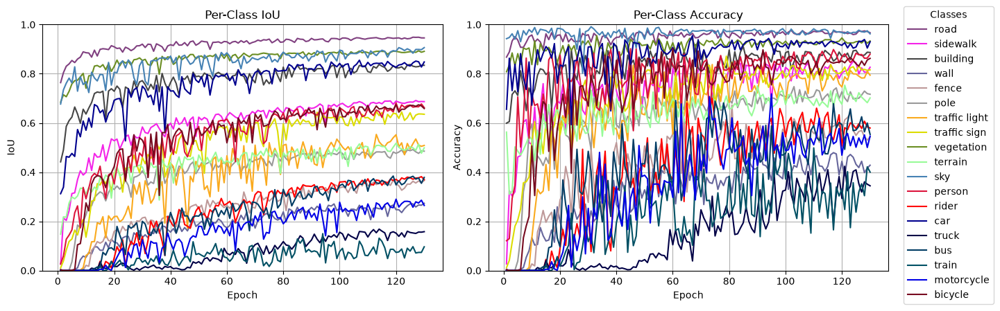

# v1.3.0-512-1024



GIF: `frankfurt_000001_012038_leftImg8bit.png`

## Data Prep

LabelIds -> TrainIds

Random crops 512 x 1024, scaled 0.5-2.0x

Random horizontal flips

Evaluation remains 1024 x 2048 resolution

## Model

Total params: 7,766,579

## Training

CPU: 14700KF | RAM: 32GB | GPU: RTX 4080S 16GB

Trained on 512 x 1024 crops for 120 epochs (out of planned 160)

120 EPOCHS = **4hrs 30mins**      

- CROP_SIZE = (512, 1024)
- CROP_SCALE = (0.5, 2.0)
- FLIP = True
- TRAIN_BATCH_SIZE = 9
- EVAL_BATCH_SIZE = 2 
- WORKER = 8 
- BASE = 32 
- CE_COEFF = 1.0
- LOVASZ_COEFF = 0.5
- MAX_LEARNING_RATE = 1e-4 
- MIN_LEARNING_RATE = 1e-6 (at 160 epochs)
- WEIGHT_DECAY = 1e-4 
- WEIGHT_EXPONENT = 0.5

Cosine Annealing learning rate

Raw weights based on frequency from exploratory data analysis
```python
freq = [36.779, 6.392, 22.557, 0.622, 0.899, 1.241, 0.206, 0.549, 16.102, 1.158, 4.108, 1.227, 0.147, 6.735, 0.233, 0.260, 0.237, 0.096, 0.450]
```

Median frequency balancing applied with an exponent weight
```python
weights = (freq.median() / freq) ** WEIGHT_EXPONENT
```

```python
ce = nn.CrossEntropyLoss(weight=weights.to(device), ignore_index=IGNORE_INDEX)
lovasz = LovaszLoss(mode="multiclass", from_logits=True, ignore_index=IGNORE_INDEX)
```

criterion = `CE_COEFF * ce(logits, masks) + LOVASZ_COEFF * lovasz(logits, masks)`

optimizer = `torch.optim.AdamW(model.parameters(), lr=LEARNING_RATE, weight_decay=WEIGHT_DECAY)`





Saved:

```
Epoch 130/160 | train loss: 0.6832 | valid loss: 0.6811 | mIoU: 0.5509 | pixel acc: 0.9114 | class acc: 0.7195 | ETA: 02:59:35
```

## Evaluation

Test evaluation: `['dusseldorf', 'jena', 'stuttgart']`

```
Pixel Accuracy:       91.7056%
Mean IoU (mIoU):      55.6871%
Mean Class Accuracy:  73.7495%

Per-class results:
-------------------------------------------------------
road                 IoU:   95.6653% | Accuracy:   97.7851%
sidewalk             IoU:   70.3484% | Accuracy:   80.2137%
building             IoU:   84.5059% | Accuracy:   88.9649%
wall                 IoU:   33.8602% | Accuracy:   53.1447%
fence                IoU:   36.7188% | Accuracy:   56.6202%
pole                 IoU:   41.9468% | Accuracy:   68.5490%
traffic light        IoU:   49.7340% | Accuracy:   80.0596%
traffic sign         IoU:   60.1695% | Accuracy:   81.0736%
vegetation           IoU:   87.3762% | Accuracy:   91.9713%
terrain              IoU:   61.2188% | Accuracy:   81.1873%
sky                  IoU:   92.3363% | Accuracy:   97.1035%
person               IoU:   69.8646% | Accuracy:   81.4419%
rider                IoU:   29.4723% | Accuracy:   67.8387%
car                  IoU:   86.2421% | Accuracy:   96.0448%
truck                IoU:   18.1728% | Accuracy:   32.5007%
bus                  IoU:   22.9724% | Accuracy:   55.5645%
train                IoU:   20.1703% | Accuracy:   53.0556%
motorcycle           IoU:   41.8734% | Accuracy:   64.6924%
bicycle              IoU:   55.4062% | Accuracy:   73.4298%
```

## Conclusions

Model trained on **512 x 1024** resolution crops, with the loss function 1.0(weightedCE) + 0.5(Lovasz). Cosine Annealing learing rate applied.

The Lovas Softmax loss function costs slight extra computation and memory, but directly focuses on IoU. Increased mIoU validation performance is noticable even during early epochs.

Much better performance with rare classes such as truck, bus or train. Poles, edges and this strucutres become clearer in the later stages of training.

The decreasing learning rate worked and its effects are visible in the loss graph. As epoch progress to later stages, training and validaiton loss vary less.

Although the model trained significantly longer, performance increased even at comparable epochs. 

With the extra epochs it was able to get a much higher evaluation scores that the baseline would have likely never reached. 

- Pixel Accuracy:       +1%
- Mean IoU (mIoU):      +15%
- Mean Class Accuracy:  +25% 

Further refinements could be made by tuning parameters or altering the model structure. The limited amount of training data could become a performance limiting factor.
