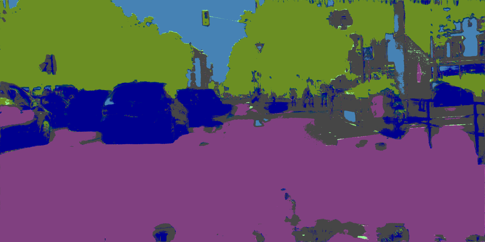
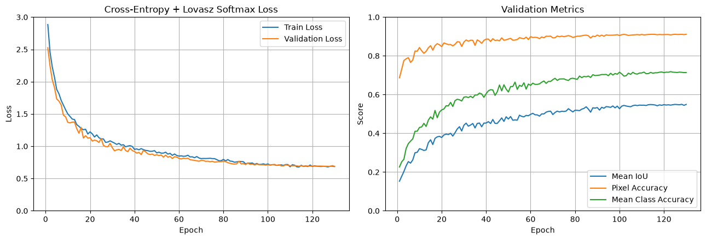
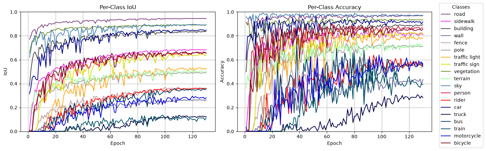

# v2.0.0-512-1024



GIF: `frankfurt_000001_012038_leftImg8bit.png`

## Data Prep

LabelIds -> TrainIds

Random crops 512 x 1024, scaled 0.5-2.0x

Random horizontal flips

Evaluation remains 1024 x 2048 resolution

## Model

Total params: 8,112,563

Residual layers: Down1, Down2, Down3, Down4, Up1, Up2, Up3

## Training

CPU: 14700KF | RAM: 32GB | GPU: RTX 4080S 16GB

Trained on 512 x 1024 crops for 130 epochs

120 EPOCHS = **6hrs 30mins**      

- CROP_SIZE = (512, 1024)
- CROP_SCALE = (0.5, 2.0)
- FLIP = True
- TRAIN_BATCH_SIZE = 8
- EVAL_BATCH_SIZE = 2 
- WORKER = 8 
- BASE = 32 
- CE_COEFF = 1.0
- LOVASZ_COEFF = 0.5
- MAX_LEARNING_RATE = 1e-4 
- MIN_LEARNING_RATE = 1e-6
- WEIGHT_DECAY = 1e-4 
- WEIGHT_EXPONENT = 0.5

Cosine Annealing learning rate

Raw weights based on frequency from exploratory data analysis
```python
freq = [36.779, 6.392, 22.557, 0.622, 0.899, 1.241, 0.206, 0.549, 16.102, 1.158, 4.108, 1.227, 0.147, 6.735, 0.233, 0.260, 0.237, 0.096, 0.450]
```

Median frequency balancing applied with an exponent weight
```python
weights = (freq.median() / freq) ** WEIGHT_EXPONENT
```

```python
ce = nn.CrossEntropyLoss(weight=weights.to(device), ignore_index=IGNORE_INDEX)
lovasz = LovaszLoss(mode="multiclass", from_logits=True, ignore_index=IGNORE_INDEX)
```

criterion = `CE_COEFF * ce(logits, masks) + LOVASZ_COEFF * lovasz(logits, masks)`

optimizer = `torch.optim.AdamW(model.parameters(), lr=LEARNING_RATE, weight_decay=WEIGHT_DECAY)`





Saved:

```
Epoch 128/130 | train loss: 0.6905 | valid loss: 0.6866 | mIoU: 0.5498 | pixel acc: 0.9110 | class acc: 0.7148 | ETA: 00:03:57
```

## Evaluation

Test evaluation: `['dusseldorf', 'jena', 'stuttgart']`

```
Pixel Accuracy:       91.6240%
Mean IoU (mIoU):      55.2216%
Mean Class Accuracy:  73.0805%

Per-class results:
-------------------------------------------------------
road                 IoU:   95.3280% | Accuracy:   96.8609%
sidewalk             IoU:   69.2519% | Accuracy:   83.9245%
building             IoU:   85.0782% | Accuracy:   90.2325%
wall                 IoU:   33.2729% | Accuracy:   55.5623%
fence                IoU:   35.5053% | Accuracy:   57.5934%
pole                 IoU:   42.3008% | Accuracy:   64.9734%
traffic light        IoU:   49.9557% | Accuracy:   79.0441%
traffic sign         IoU:   61.5936% | Accuracy:   78.7583%
vegetation           IoU:   87.3735% | Accuracy:   91.8921%
terrain              IoU:   60.5835% | Accuracy:   84.4519%
sky                  IoU:   91.5162% | Accuracy:   96.8755%
person               IoU:   68.8115% | Accuracy:   79.4661%
rider                IoU:   28.5852% | Accuracy:   64.0067%
car                  IoU:   86.5170% | Accuracy:   94.3363%
truck                IoU:   13.5443% | Accuracy:   23.0196%
bus                  IoU:   19.0747% | Accuracy:   54.0484%
train                IoU:   24.4748% | Accuracy:   49.7006%
motorcycle           IoU:   43.7905% | Accuracy:   67.6346%
bicycle              IoU:   52.6519% | Accuracy:   76.1484%
```

## Conclusions

Model used residual layers, which were meant to make the model easier to train. Instead the model used more memory, required smaller batches and took longer to train by around 40%. The residual model achieved comparable performance, but at a higher computational cost.

This could be due to a slight learning rate mismatch. The previous run was scheduled to finish at 160, but ended at 130, while this one was scheduled to finish at 130 and did. This run had a lower learning rate towards the end. During training the residual model seemed to advance slightly quicker, although its exact effect is uncertain.

Given the additional computational cost and lack of a clear accuracy improvement, residual connections do not appear worthwhile for this particular U-Net configuration.
