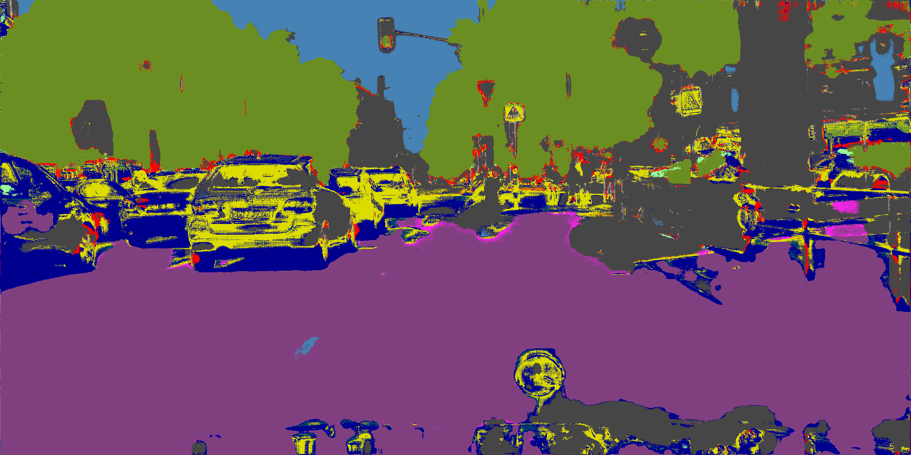
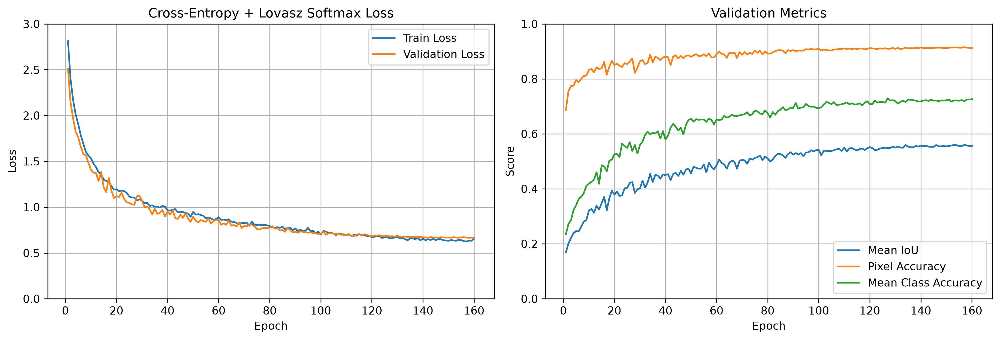
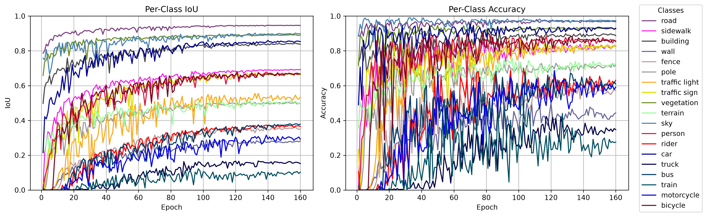

# v2.0.6-512-1024-submission



GIF: `frankfurt_000001_012038_leftImg8bit.png`

## Data Prep

LabelIds -> TrainIds

Random crops 512 x 1024, scaled 0.5-2.0x

Random horizontal flips

Evaluation remains 1024 x 2048 resolution

## Model

Total params: 8,112,563

Residual layers: Down1, Down2, Down3, Down4, Up1, Up2, Up3

## Training

CPU: 14700KF | RAM: 32GB | GPU: RTX 4080S 16GB

Trained on 512 x 1024 crops for 160 epochs

130 EPOCHS = **6hrs 30mins**      

- CROP_SIZE = (512, 1024)
- CROP_SCALE = (0.5, 2.0)
- FLIP = True
- TRAIN_BATCH_SIZE = 8
- EVAL_BATCH_SIZE = 2 
- WORKER = 8 
- BASE = 32 
- CE_COEFF = 1.0
- LOVASZ_COEFF = 0.5
- MAX_LEARNING_RATE = 1e-4 
- MIN_LEARNING_RATE = 1e-6
- WEIGHT_DECAY = 1e-4 
- WEIGHT_EXPONENT = 0.5

Cosine Annealing learning rate

Raw weights based on frequency from exploratory data analysis
```python
freq = [36.779, 6.392, 22.557, 0.622, 0.899, 1.241, 0.206, 0.549, 16.102, 1.158, 4.108, 1.227, 0.147, 6.735, 0.233, 0.260, 0.237, 0.096, 0.450]
```

Median frequency balancing applied with an exponent weight
```python
weights = (freq.median() / freq) ** WEIGHT_EXPONENT
```

```python
ce = nn.CrossEntropyLoss(weight=weights.to(device), ignore_index=IGNORE_INDEX)
lovasz = LovaszLoss(mode="multiclass", from_logits=True, ignore_index=IGNORE_INDEX)
```

criterion = `CE_COEFF * ce(logits, masks) + LOVASZ_COEFF * lovasz(logits, masks)`

optimizer = `torch.optim.AdamW(model.parameters(), lr=LEARNING_RATE, weight_decay=WEIGHT_DECAY)`





Saved:

```
Epoch 157/160 | train loss: 0.6254 | valid loss: 0.6685 | mIoU: 0.5604 | pixel acc: 0.9152 | class acc: 0.7190 | ETA: 00:06:03
```

## Evaluation

Test evaluation: `['dusseldorf', 'jena', 'stuttgart']`

```
Pixel Accuracy:       92.0421%
Mean IoU (mIoU):      56.6579%
Mean Class Accuracy:  74.0812%

Per-class results:
-------------------------------------------------------
road                 IoU:   95.5016% | Accuracy:   97.2153%
sidewalk             IoU:   70.4764% | Accuracy:   82.0344%
building             IoU:   85.8947% | Accuracy:   91.2153%
wall                 IoU:   33.9570% | Accuracy:   53.0536%
fence                IoU:   36.5359% | Accuracy:   57.1607%
pole                 IoU:   44.1294% | Accuracy:   65.5635%
traffic light        IoU:   50.7923% | Accuracy:   80.4248%
traffic sign         IoU:   64.2553% | Accuracy:   80.1419%
vegetation           IoU:   87.5672% | Accuracy:   91.8035%
terrain              IoU:   61.7409% | Accuracy:   83.0927%
sky                  IoU:   91.9723% | Accuracy:   96.9487%
person               IoU:   70.0300% | Accuracy:   81.6907%
rider                IoU:   28.4743% | Accuracy:   66.3065%
car                  IoU:   86.4109% | Accuracy:   95.5431%
truck                IoU:   19.0423% | Accuracy:   32.5865%
bus                  IoU:   23.2668% | Accuracy:   58.7699%
train                IoU:   28.4003% | Accuracy:   48.7717%
motorcycle           IoU:   43.3096% | Accuracy:   69.2258%
bicycle              IoU:   54.7422% | Accuracy:   75.9947%
```

## Conclusions

Final submission model results.

Model used residual layers, and same training parameter setup as v1.3.0, but ran for the whole 160 epochs.

Overall the introduction of residual layers resulted in minimal gains across the board. 
